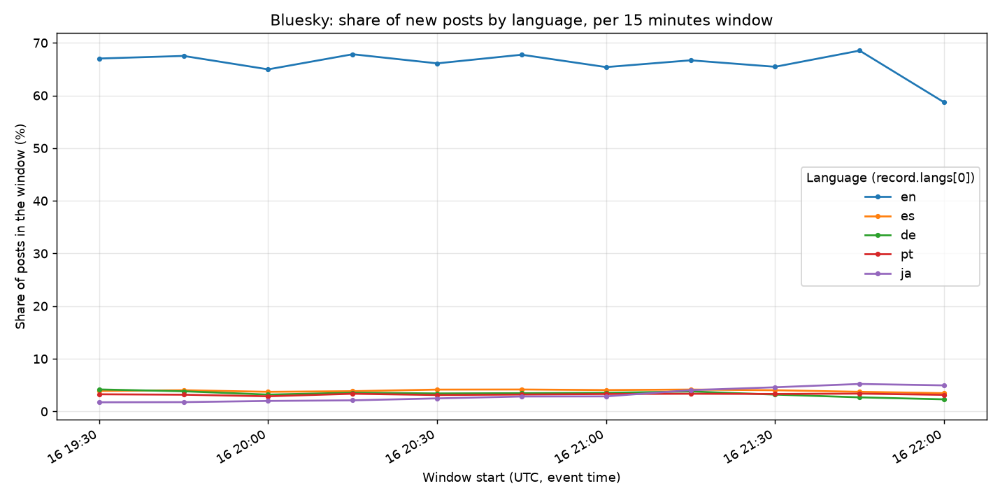

# TODO: Bluesky language rhythms: a Kafka streaming pipeline

**Author:** Nelson Lattimer
**DS 3022 Data Project 3, Fall 2026**

## Data source

Bluesky posts from **Jetstream**, the public JSON version of the Bluesky firehose:
`wss://jetstream2.us-east.bsky.network/subscribe?wantedCollections=app.bsky.feed.post`.
It is a **push** source (WebSocket): the server sends every new post (and every post deletion) on the network as it happens, about **50 posts per second** (measured with `python probe.py bluesky` on Mon 16 Nov, 22:47 CET). No account or key is needed; the producer sends a User-Agent header. One message is one event: `did` (the account), `time_us` (when Jetstream received it, in microseconds), `kind`, and for posts a `commit` with `operation` (create/delete), `rkey` (the post id within the account) and `record` (text, `langs`, `createdAt`, `reply`, `embed`). Jetstream can **replay** a limited window with `?cursor=<time_us>`: I used it to backfill the last 2 hours before going live (`--replay 120`).

## How to run

From a fresh clone, on Windows PowerShell (macOS/Linux commands in comments). Docker Desktop must be running.

```bash
cd ds3022-streaming
py -m venv .venv                       # macOS/Linux: python3 -m venv .venv
.venv\Scripts\Activate.ps1             # macOS/Linux: source .venv/bin/activate
pip install -r requirements.txt
pip install confluent-kafka requests tornado duckdb prefect matplotlib
docker compose up -d
docker exec -it redpanda-0 rpk topic create bluesky_posts -p 3 -r 3
cd project3
```

Then, each in its own terminal (activate the venv in each, from `project3`: `..\.venv\Scripts\Activate.ps1`):

```bash
python producer.py --replay 120     # T1: replay the last 2 h, then live (Ctrl+C to stop; --limit N to stop after N)
python lander.py                    # T2: writes data/raw/*.parquet (Ctrl+C to stop)
python flow.py                      # T3: full data -> bluesky.duckdb, charts/language_share.png
```

Without Kafka, on the committed sample:

```bash
cd project3
python flow.py data/sample          # -> bluesky_sample.duckdb, charts/language_share_sample.png
```

The scripts reach the cluster at `localhost:19092` (set `KAFKA_BOOTSTRAP` to change it). Optional Prefect dashboard: `prefect server start` in another terminal, then `$env:PREFECT_API_URL="http://127.0.0.1:4200/api"` (macOS/Linux: `export PREFECT_API_URL=...`) before `python flow.py`.

## Architecture

```
 Jetstream (wss, push, ~50 posts/s)
        │  producer.py   envelope {"action","data"}, key = did, reconnect + resume from cursor
        ▼
 Kafka topic  bluesky_posts   (3 partitions, replication factor 3, 3 Redpanda brokers)
        │  lander.py     group bluesky_posts_lander, 1,000 records or 60 s per file,
        │                .tmp → rename, offsets stored after the file, bad input → action='malformed'
        ▼
 data/raw/bluesky_<time>_<id>.parquet     (kafka_partition, kafka_offset, kafka_key, action,
        │                                   did, rkey, operation, kind, collection, time_us, landed_at, raw)
        │  flow.py  (Prefect flow "bluesky-pipeline", DuckDB file bluesky.duckdb)
        ▼
 load_raw → raw ─► stage → stage ─► entities → posts ─► marts → mart_top_langs,
                                                               mart_lang_windows, mart_lang_summary
                                                        ─► charts → charts/language_share.png
                                                        ─► four_numbers (logged)
```

Evidence: `docs/topic.png` (topic with 3 partitions), `docs/flow_log.png` (the four numbers), `docs/prefect_dashboard.png` (completed run).

## Design decisions

1. **Key and partitions.** The key is `did`, the account id. Kafka hashes the key, so every event of one account goes to the same partition and stays in order: a post's `create` always comes before its `delete`. With hundreds of thousands of accounts posting, the keys spread evenly: the Console showed about 130,800 messages in each of the 3 partitions. With `rkey` alone as the key, a create and its delete could still hash together, but I would lose per-account order. With a constant key (or the language), everything would land in one partition and two of the three would sit idle.
2. **Batch size and time.** A batch closes at 1,000 records or 60 seconds. Live, Bluesky sends about 50 posts per second, so 1,000 records arrive in about 20 s: the **size** rule closes almost every batch (during the 2-hour replay, even faster). That makes about 180 files per hour live. The 60 s rule only matters when the stream is quiet, or for the last partial batch (for example after the poison message in D2).
3. **Offsets after the file.** If the lander crashes after the file is renamed but before `store_offsets`, Kafka still has the old position, so after a restart the same records are read and landed again in a second file. Nothing is lost, but there are duplicates (at-least-once delivery). I accept that because the flow removes them: in card D1 exactly 1,000 extra raw rows appeared and the unique Kafka records did not include them. Storing offsets before the file would risk the opposite (records marked as read but never written), which cannot be repaired.
4. **Duplicates.** Two rows are the **same Kafka record** when they have the same `kafka_partition` + `kafka_offset` (re-landed after a crash). The stage step keeps one with `QUALIFY row_number() OVER (PARTITION BY kafka_partition, kafka_offset ORDER BY landed_at) = 1`. Two records are the **same post** when they have the same `did` + `rkey`, even with different offsets (for example when I replayed with `--replay 10` in D5). The entity step keeps one `create` per post with `QUALIFY row_number() OVER (PARTITION BY did, rkey ORDER BY kafka_partition, kafka_offset) = 1`, and a later `delete` only sets `deleted_later`. In the full data, 500,045 unique Kafka records became 441,957 unique posts.
5. **Windows and time.** I use **event time**: `time_us`, the moment Jetstream received the post, converted with `make_timestamp(time_us)` (UTC). Landing time would be wrong here because the 2-hour replay landed in a few minutes, so all replayed posts would fall into one window. I did not use the post's own `createdAt` because it is set by the user's app and can be wrong or backdated. I chose **15-minute** windows: I have about 2.5 hours of data, so this gives about 10 windows with thousands of posts each, enough to see shares move without too much noise.
6. **Ten times the volume.** At about 500 posts per second, the **lander** would break first. It inserts rows into DuckDB one batch at a time with `executemany`: during the replay it landed about 360 records per second and fell behind (392,541 messages in the topic when only 121,000 were landed). I would build each batch as a PyArrow table and write it in one call, raise the batch size to 10,000, and run three lander processes in the same consumer group, one per partition. The topic would also grow by about 1 GB every 15 minutes, so I would shorten its retention.

## Chaos round

| Card | Prediction | What I did | Numbers before → after | Explanation |
|---|---|---|---|---|
| D1 Crash between file and offsets | Raw goes up by about 2× the crashed batch, unique Kafka records by 1×, nothing lost | Stopped the lander, let the producer run 1 min, ran `python lander.py crash` (landed 1,000 records, then exited before storing offsets), restarted `python lander.py`, ran the flow | raw 435,000 → 455,359; malformed 1 → 1; unique Kafka records 434,999 → 454,358; unique posts 408,122 → 426,144. raw − unique − malformed: 0 → **1,000** | The offsets were stored only after the file existed, so after the crash Kafka gave the same 1,000 records again and they were landed twice (at-least-once). The stage dedupe on partition + offset removed the copy, so exactly the crashed batch (1,000) is the gap between raw and unique Kafka records. The growth in unique records is new live posts. |
| D2 Poison message | The lander keeps running; malformed goes from 0 to 1; unique Kafka records and posts do not change because of it | `docker exec -it redpanda-0 rpk topic produce bluesky_posts -k bad`, typed `this is not JSON`, waited for the lander's `(1 malformed)` line, ran the flow | raw 121,000 → 435,000; malformed **0 → 1**; unique Kafka records 121,000 → 434,999; unique posts 112,804 → 408,122 (the rest of the growth is the replay backlog being landed) | `to_row()` caught the JSON error and landed the text with `action = 'malformed'`, so the lander did not crash and did not block partition reading (no poison loop). The flow keeps it in raw (raw = unique + 1) and leaves it out of stage and posts. Land everything, decide later. |
| D5 Send it all again | Raw and unique Kafka records go up by the replayed amount; unique posts do not (apart from new live posts) | Stopped the producer, ran `python producer.py --replay 10` (re-sent the last 10 minutes of posts I had already landed), waited 2 min, ran the flow | raw 455,359 → 486,359 (+31,000); malformed 1 → 1; unique Kafka records 454,358 → 485,358 (+31,000); unique posts 426,144 → 432,426 (only +6,282) | The same post sent again is a new Kafka record with a new offset, so the partition + offset dedupe cannot remove it. The entity step (one post per `did` + `rkey`) does: about 25,000 of the 31,000 new records were posts I already had, and only the genuinely new live posts were added. |

## The four numbers

From the flow log on the full data, after the producer and lander were stopped (screenshot of an earlier run in `docs/flow_log.png`). Two runs in a row gave the same numbers.

| Number | Full data | Sample (`data/sample`) |
|---|---:|---:|
| Raw records landed | 501,046 | 5,000 |
| Malformed (kept in raw) | 1 | 0 |
| Unique Kafka records | 500,045 | 5,000 |
| Unique posts | 441,957 | 4,693 |

The sample is 5,000 random raw rows (`python kit/make_sample.py`), so it happens not to contain the single malformed row or a re-landed copy. Unique posts are lower than unique Kafka records because the replay (D5) re-sent posts, and because `delete` and non-post events are not posts.

## Challenges / Obstacles

- **Volume and time.** I started late, so instead of waiting for live posts I used Jetstream's `?cursor=` replay: `--replay 120` backfilled 2 hours (over 390,000 messages) in a few minutes, then continued live.
- **Dropped connections.** Jetstream closed the WebSocket many times (the producer log showed 14 reconnects with 0 failed deliveries). The producer catches the error, waits 5 s, and reconnects with `cursor` = the last `time_us` it sent, so there is no gap.
- **The lander fell behind** during the fast replay (392,541 messages in the topic, 121,000 landed at the first flow run). It caught up after about 15 minutes, which is why I name it as the first bottleneck at 10× volume.

## Analysis

**Question:** when is each language community active on Bluesky? For each 15-minute window (event time, 19:30–22:00 UTC on Mon 16 Nov), what share of new posts is in each of the top languages, and do they reply differently? English dominates every window (58.7–68.5% of posts), but the smaller languages move with their local clocks. German peaks at 4.2% at 19:30 UTC (20:30 in Berlin) and falls to 2.3% as Germany goes to bed. Japanese rises from 1.7% to 5.2% by 21:45 UTC, which is 06:45 in Tokyo: the Japanese morning starts while Europe's evening ends. The less obvious finding is how differently communities use the network. 67.6% of German posts are replies, but only 29.5% of Japanese posts, and only 11.6% of posts with **no language tag**. Those untagged posts also jumped to 20% of the 22:00 window, which suggests automated accounts (bots usually broadcast and do not reply), though I did not check this. **Limitations:** I have only about 2.5 hours of one evening, so I cannot separate a daily rhythm from a one-off event. `langs` is chosen by the user's app (often its default setting), not detected from the text. The last window is incomplete, and the D5 replay was deduplicated but changes no shares.

## Plot / Visualization



## Reflection

Before this project I thought of streaming as just "data that keeps arriving". Building this pipeline showed me that the hard part is what happens when something goes wrong. Card D1 made at-least-once delivery concrete: the crash produced exactly 1,000 duplicate rows, and I finally understood why storing offsets after the file means duplicates but never lost data. Card D5 taught me that a Kafka record and a real-world thing are not the same: the same post sent twice gets a new offset, so only the entity step can catch it. I also learned that a WebSocket source drops all the time, so the producer has to expect it. If I started again, I would start on time instead of building everything on the last day, so I could collect several days of data and check whether the language rhythms repeat. I would also make the lander write faster, since it fell behind during the replay.

## Acknowledgements

- **AI assistance:** I used Claude (Anthropic) throughout this project. It explained the concepts to me (Kafka offsets, the two kinds of duplicates, the chaos cards).
- **Reused code:** The pipeline structure (envelope, batching, offsets after the file, the two kinds of duplicates) follows the class scripts from Mon 02 Nov.
- **People:** Lanvy reviewed my project and ran it from this README on Mon 16 Nov (README peer test).
- **Sources:** Bluesky Jetstream documentation (github.com/bluesky-social/jetstream); DuckDB JSON functions documentation.